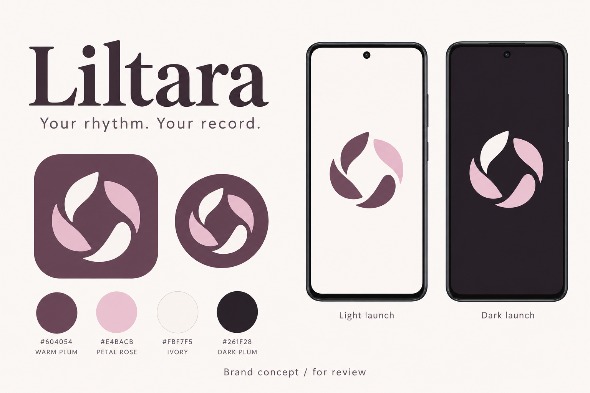
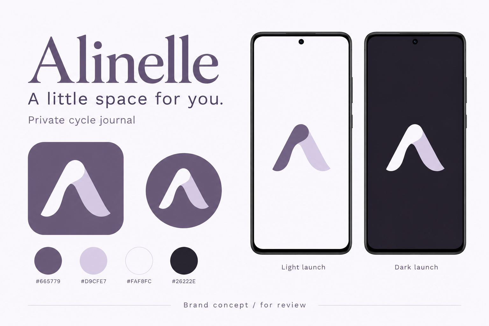
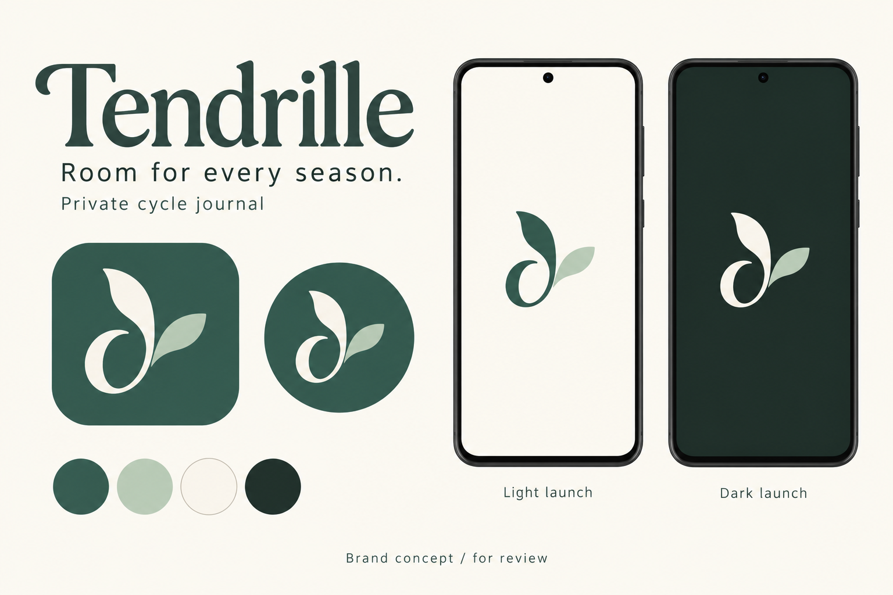

# Brand and marketing proposal — October 20, 2026

**Status: proposed; awaiting the owner's choice and design approval.** The owner requested an official name, app icon, launch screen and related marketing work. The current app remains Cycle Tracker preview 0.21.0. No app assets, display names, identifiers, behavior or release status have changed.

## Recommendation: Liltara

**Liltara** (proposed pronunciation: lil-TAR-ah) is the strongest direction. The name suggests a lilt or changing rhythm without promising regular cycles. The plum-and-rose petal mark feels feminine and familiar beside the existing appearance choices. A descriptive store title makes the function clear.

**Tagline:** Your rhythm. Your record.

**Descriptor:** Private cycle journal.

**Positioning:** A private period and perimenopause journal that helps people keep useful everyday records, see their recorded history, and prepare for conversations with their clinician.

Lead with recording, privacy and everyday usefulness. Perimenopause deserves a clear mention, while the app remains useful for people simply tracking periods. Predictions are experimental and secondary to the product story.

## Three concrete directions

These generated boards show the proposed wordmark, launcher icon with two masks, palette, and Android light/dark launch screens. They are design concepts, not screenshots of a new build or production icon exports.

| Direction           | Name and character                          | Icon                                           | Tagline                   | Main tradeoff                                                                            |
| ------------------- | ------------------------------------------- | ---------------------------------------------- | ------------------------- | ---------------------------------------------------------------------------------------- |
| **1 — recommended** | **Liltara** · warm, feminine, contemporary  | Curved petals forming an open circular embrace | Your rhythm. Your record. | An unfamiliar name needs the descriptive store title.                                    |
| 2                   | **Alinelle** · lilac, personal, understated | A folded ribbon forming an abstract A          | A little space for you.   | Pleasant but less connected to cycle tracking; unrelated uses of the name already exist. |
| 3                   | **Tendrille** · botanical, grounded, gentle | A curled stem and two leaves                   | Room for every season.    | The spelling may need explanation; unrelated editorial uses already exist.               |

### 1. Liltara

| Role         | Color                |
| ------------ | -------------------- |
| Main brand   | Warm plum `#604054`  |
| Accent       | Petal rose `#E4BACB` |
| Light launch | Ivory `#FBF7F5`      |
| Dark launch  | Dark plum `#261F28`  |

The generated concept resolves into four curved petals, rather than the three requested in the exploratory prompt. The displayed four-petal mark is the proposal being reviewed. The descriptor remains part of the brand copy even though this board omitted it.

### 2. Alinelle

Proposed pronunciation: ah-lih-NELL. Main violet `#665779`, pale lilac `#D9CFE7`, porcelain `#FAF8FC`, dark violet `#26222E`. The abstract monogram offers a discreet personal-journal identity.

### 3. Tendrille

Proposed pronunciation: TEN-drill. Main botanical teal `#365C53`, sage `#C9D8CC`, cream `#FAF8F1`, dark forest `#1E2C28`. The seasonal idea refers to changes in someone's life, not a claim that their cycle follows a fixed schedule.

## What approval would cover

Choosing a direction approves its name, emblem, wordmark style, brand colors, tagline, and the simple Android launch treatment shown above. Production refinement would preserve that direction while making clean vector artwork and platform-specific exports. A materially different mark or new app layout would return for review.

The name and mark would appear in the launcher label/icon, existing app header, existing welcome/unlock branding, browser tab/icon/install metadata, About/help text and generated report branding. Existing user-selected palettes, backgrounds and the approved Calendar & journal layout remain available. Brand colors identify the app; they do not force every journal into one palette.

The display name would become the chosen name, with **Preview** retained in testing build labels. Keep the existing application IDs, URL schemes, journal storage keys, backup format, signing identity and repository name. A brand update must install over the current preview and retain its data.

This approval is for brand implementation and preparing marketing assets. It does not publish a store listing, register a domain, buy a font, set a price or declare a 1.0 release.

## Launch experience

**Android:** a centered emblem on a solid light or dark background, then the existing welcome/unlock screen as soon as it is ready. No slogan, progress theater, mandatory animation or minimum branding delay. A genuine initialization failure must expose a useful recovery state rather than leave the launch screen indefinitely visible. The large illustrations on the boards demonstrate the mark; final scale must fit Android's native safe area.

**iOS later:** use a launch surface matching the first screen's background and fixed elements. Apple recommends keeping launch screens visually close to the first app screen and avoiding advertising or static text. Put the wordmark and useful explanatory copy in the actual welcome/unlock screen. The Android phone concepts are not an approved iOS launch implementation. [Apple launch guidance](https://developer.apple.com/design/human-interface-guidelines/launching).

**Computer:** use the same mark for browser/favicon/install assets and the existing header. Do not add a timed full-screen interstitial to the web app.

Android's native launch API supports a centered icon and solid background. Expo supports platform-specific launch configuration; verify the result in a preview or production build rather than Expo Go. [Android splash guidance](https://developer.android.com/develop/ui/views/launch/splash-screen) · [Expo icon and splash guide](https://docs.expo.dev/develop/user-interface/splash-screen-and-app-icon/).

## Draft store copy

The following uses Liltara as the proposed name. It describes the implemented local feature set; publication still depends on release readiness and the applicable platform build.

**Store title:** Liltara: Period Journal

**Apple subtitle draft:** Periods & perimenopause

**Google Play short description draft:**

> Private period and perimenopause tracking, symptoms, sleep and care records

**Full description draft:**

> Your rhythm. Your record.
>
> Liltara is a private journal for periods, perimenopause and the everyday details you want to remember.
>
> Record a period with a start and end date, then add flow details whenever you need them. Keep symptoms, moods, sleep and medication records together, and look back through your calendar and history.
>
> Make it yours
>
> Pin the symptoms you use most, arrange your daily journal sections, and choose soft colors and backgrounds.
>
> Keep useful records
>
> Record the medication schedules and reminders you choose. Keep notes, appointments and questions together, and create a summary of selected records for a clinician visit.
>
> Add sleep from Health Connect
>
> On supported Android phones, import sleep shared by a compatible source app. You control access and can review multiple nights together. Available records and sleep stages depend on the source.
>
> Keep control of your journal
>
> Your journal is encrypted on your device and works offline without an account. Use a passphrase, with optional biometric unlock on supported phones. Create encrypted backups and choose which records to include in readable exports. Keep your passphrase and backups somewhere safe; we cannot recover them for you.
>
> Liltara records information you enter or choose to import. It does not provide medical advice, diagnosis or treatment. Optional period estimates are experimental and must not be used for contraception or to make medical decisions.

The Health Connect paragraph is Android-specific and must be adapted for the eventual iOS listing to describe only its implemented features. “Works offline” describes the local journal, not fetching new records from another app's cloud service. Readable exports are deliberately not encrypted. This copy is not a substitute for the final public privacy policy or store declarations.

Google Play permits 30 characters in the title, 80 in the short description and 4,000 in the full description. Keep promotional pricing language out of the title and short description. [Listing limits](https://support.google.com/googleplay/android-developer/answer/9859152?hl=en-EN) · [Metadata policy](https://support.google.com/googleplay/android-developer/answer/9898842?hl=en).

## Store imagery and related materials

Proposed screenshot sequence, using fictional sample data and actual app screens after branding is implemented:

| Order | Headline                           | Screen and evidence                                                                                       |
| ----- | ---------------------------------- | --------------------------------------------------------------------------------------------------------- |
| 1     | Your cycle, clearly recorded       | Calendar and compact current-cycle summary; show actual recorded data.                                    |
| 2     | Add a whole period at once         | Existing start/end period form.                                                                           |
| 3     | A journal that fits you            | Daily sections, pinned symptoms and one approved appearance.                                              |
| 4     | See your recorded history          | Cycle/bleeding charts; make missing records and uncertainty visible.                                      |
| 5     | Bring sleep into the picture       | Android multi-night Health Connect review and saved nights; no Fitbit endorsement or direct-device claim. |
| 6     | Useful records for your next visit | Selected-record doctor summary, with sample content.                                                      |
| 7     | Your journal, under your control   | Passphrase/biometric options, encrypted backup and export controls.                                       |

Prepare a Play feature graphic with the chosen emblem, wordmark and tagline; a square social/avatar image; a wide social/share image; web install icons and favicon; and a short brand reference. Store screenshots must reflect the real app, so the generated concept boards must not be uploaded as screenshots. Google requires a feature graphic and supplies specifications for each asset. [Play preview assets](https://support.google.com/googleplay/android-developer/answer/9866151?hl=en-en).

Use short, factual copy. Avoid predictions as the lead benefit, hormone-balance claims, fertility accuracy claims, diagnostic language, endorsements, fabricated testimonials and claims of absolute security. Use “record,” “review,” “choose” and “your journal.” No guilt about missed days, no fixed-cycle ideal, no cutesy labels for symptoms.

The existing commercial direction is a modest upfront purchase for the local app; the amount remains undecided. Do not promise perpetual hosted sync or a subscription-free cloud service.

## Preliminary name screening

Checked October 20, 2026 using exact-name web searches, name + app/period/health queries and indexed Google Play/App Store searches. This is a search-collision screen, not trademark clearance, a registry search, a domain-availability check or an app-name reservation. Search indexes can miss products and regional listings.

| Candidate | Observed result                                                                                                                                                                                                                                                                                                          |
| --------- | ------------------------------------------------------------------------------------------------------------------------------------------------------------------------------------------------------------------------------------------------------------------------------------------------------------------------ |
| Liltara   | No exact-name app listing surfaced in the searches performed. Broader searches returned unrelated text/name occurrences. Best of this shortlist for further evaluation.                                                                                                                                                  |
| Alinelle  | No exact-name app listing surfaced. The name is used outside apps, including an [electrical company in Sweden](https://e-tjanster.elsakerhetsverket.se/DownloadRegisterExtract?id=11717018) and a [recording artist](https://www.qobuz.com/us-en/album/528hz-tibetan-bowls-for-chakra-balancing-alinelle/pcd7g1scj11la). |
| Tendrille | No exact-name app listing surfaced. Existing editorial uses include [Quarelia's family section](https://quarelia.com/univers/tendrille/) and a [personal publication](https://medium.com/@tendrille/why-im-renaming-this-space-240d15d04d84).                                                                            |

Examples rejected during exploration: [Roselle](https://www.rosellepreiod.com/) is already a period/wellness product; [Petaline](https://apps.apple.com/tw/app/petaline/id6758908150) is already a habit/reflection app; [PetalKeep](https://petalkeep.app/) is a habit tracker; [Daypetal](https://daypetal.com/) is a diary; [Petalune](https://play.google.com/store/apps/details?hl=en_US&id=com.tusydh.Petalune) is a game; [Velmira](https://apps.apple.com/ca/app/velmira-ai-companion/id6777704671) is an affirmation/journal app. This is why the shortlist avoids those names.

Exact shortlist searches included `"Liltara"`, `"Liltara" app`, `"Liltara" "period"`, `"Liltara" site:play.google.com`, `"Liltara" site:apps.apple.com`, `"Alinelle"`, `"Alinelle" app cycle health`, and `"Alinelle"` / `"Tendrille"` with `(site:apps.apple.com OR site:play.google.com)`.

## Production handoff after approval

1. Make clean, scalable source artwork for the selected mark and wordmark, plus a single-color mark. Preserve the approved silhouette. Generated boards are reference art, not asset sheets to crop into production.
2. Export Android adaptive foreground/background and monochrome layers with native safe-area padding, a legacy icon, transparent PNG launch marks, light/dark backgrounds and web icons. Prepare an opaque square 1024px icon master for eventual iOS work; do not bake rounded corners into the export. [Expo platform asset guidance](https://docs.expo.dev/develop/user-interface/splash-screen-and-app-icon/).
3. Apply display-name and brand replacements, retain the Preview distinction, and audit user-visible permissions, notifications, reports, web metadata and help copy for inconsistent old naming.
4. Check marks at 24/48/96px and with circle/squircle masks, Android themed icons, light/dark appearance, large text and computer widths. Confirm that the selected personal appearance still works.
5. Run `pnpm typecheck` and production web/native builds; visually check the launch-to-unlock transition and retain explicit phone validation for Pixel 7 and Galaxy Z Flip5. Test cold launch, warm resume, no white flash, no double splash and update installation with the existing journal.
6. Capture the real branded sample screens and prepare the store/share images. Record implemented results separately from device reports and release approval.

## Art provenance and review

All three PNG boards were generated with the built-in **image_gen** tool. The exact common prompt and each direction's prompt are saved in [prompts.json](prompts.json); concatenate `commonPrompt`, a newline and the selected direction's `prompt` to reproduce the request. Original outputs remain in the local generated-images directory; the three review deliverables are copied into this repository beside this document.

The boards were visually reviewed for legible names/taglines, consistent emblems across masks and launch screens, and light/dark presentation. They have not been tested as native icons or on real phones. The colors above are the intended production values; generated pixels are illustrative. No external font file is embedded in this proposal.
