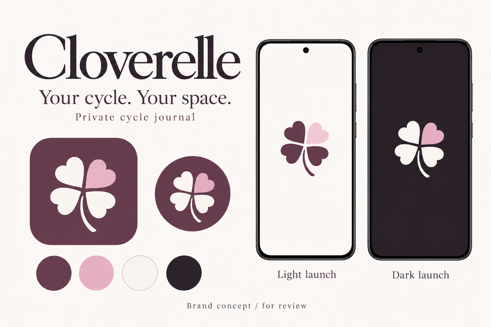
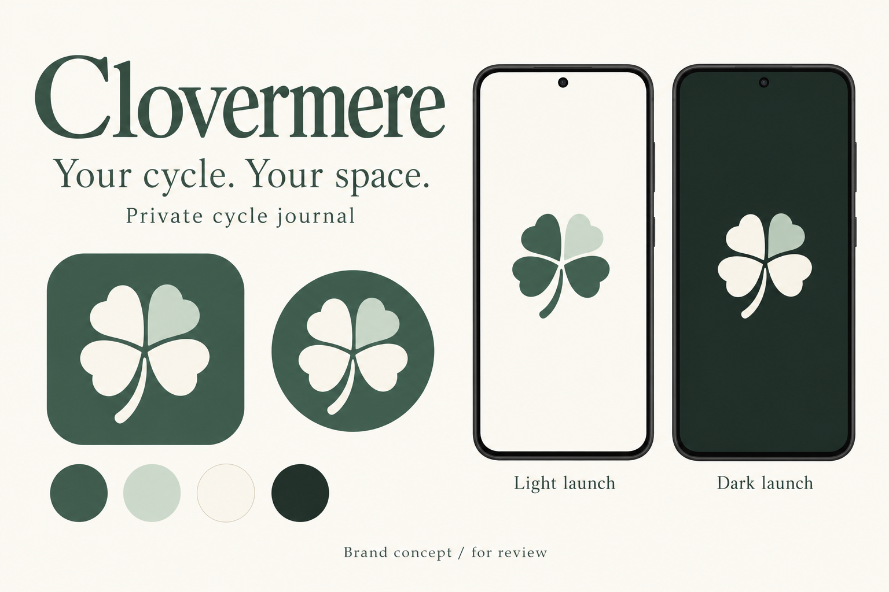

# Clover brand direction — October 27, 2026

**Status: proposals for review.** The owner requested a name based on Clover, with a four-leaf-clover emblem and icon. This becomes the active naming direction; the October 20 names remain historical, unapproved alternatives. No specific derivative, mark or palette has been selected yet. The app remains Cycle Tracker preview 0.21.0.

## The two proposals

Both concepts use exactly four leaves and a short curved stem, a readable serif wordmark, and a simple emblem on solid light/dark Android launch backgrounds. The names and visual treatments can be mixed; choosing a name does not require choosing its pictured palette.

| Name           | Pronunciation | Character                                                                          | Visual treatment                                                       |
| -------------- | ------------- | ---------------------------------------------------------------------------------- | ---------------------------------------------------------------------- |
| **Cloverelle** | clover-ELL    | The more feminine, personal name; my preference for sound and connection to Clover | Plum and ivory with one rose leaf; four soft heart-shaped leaves       |
| **Clovermere** | CLO-ver-meer  | A quieter botanical name                                                           | Deep sage and cream with one pale sage leaf; four broad rounded leaves |

**Proposed tagline:** Your cycle. Your space.

**Descriptor:** Private cycle journal.

**Store-title drafts:** Cloverelle: Period Journal / Clovermere: Period Journal.

The four-leaf emblem honors the owner's naming idea. It makes no claim about luck, health outcomes, fertility or a four-stage personal cycle. Public marketing need not disclose the private inspiration for the name.

### Cloverelle — plum and rose

Warm plum `#604054`, rose `#E4BACB`, ivory `#FBF7F5`, dark plum `#261F28`. Three ivory leaves and one rose leaf create a recognizable accent on the plum launcher tile. The light launch uses a mostly plum mark. The four broad leaves and stem should also work as a single-color silhouette after production refinement.

### Clovermere — sage and cream

Deep sage `#3F6254`, pale sage `#C7D9CB`, cream `#FAF8F1`, dark forest `#1F2C26`. A fuller leaf shape and gently curved stem give a botanical character. The light-launch accent needs a darker sage in production if the pale generated leaf loses definition.

## Naming findings

**Plain Clover has a direct category collision.** Wachanga LTD already publishes [Clover — Period Tracker, Cycle](https://apps.apple.com/us/app/clover-period-tracker-cycle/id1423628793). I would avoid plain Clover as the public product name because users searching for a period tracker could confuse the two.

Exact-name and indexed app-store searches on October 27 returned no exact app listing for Cloverelle or Clovermere. However, [Cloverelle already has an unrelated blanket/home-goods website](https://www.cloverelle.com/), and [Clovermere is an album title](https://open.spotify.com/album/4PUnKp30I4m3nkwmSlnF7F) as well as a place-name occurrence. Cloverly and Clovera also surfaced existing software uses, so they were not developed into this pair of proposals.

This is preliminary search evidence, not trademark clearance or confirmation of domain/store-name availability. Adding a suffix does not establish that a name is sufficiently distinct from the existing Clover period app. The preference for Cloverelle is an aesthetic recommendation, not a legal conclusion.

Searches included `"Clover" "period tracker"`, `"Clover" "cycle" app`, `"Cloverly" app period`, `"Cloverelle"`, `"Cloverelle" app`, `"Clovermere" app`, `"Clovera" "period"`, and each proposed name with `(site:apps.apple.com OR site:play.google.com)`. The direct Apple listing was opened to confirm the category collision.

## Scope after selection

The [October 20 implementation and marketing brief](../branding-2026-10-20/README.md#what-approval-would-cover) still applies to the eventual selected identity: launcher icon/label, existing welcome/unlock/header branding, web icons/metadata, report branding, and marketing materials. Adapt the draft store copy to the selected name and tagline.

Keep the simple Android launch treatment: the emblem on a solid light/dark surface until the app is ready, with no added branding delay. The eventual iOS launch should follow its platform-specific first-screen treatment from the earlier brief. Do not replace user-selected palettes/backgrounds or alter the approved Calendar & journal layout.

Preserve application IDs, signing identity, schemes, journal storage keys and backup formats. Branding must install as an update over the current preview. Selecting a design does not authorize publication, a domain purchase or a 1.0 release.

The next owner decision is the name and visual direction (including any requested mix). Per the project design-approval rule, these remain review concepts until that choice is explicit.

## Files, provenance and checks

- `01-cloverelle.png` and `02-clovermere.png`: generated review boards, not production icons or real app screenshots.
- [prompts.json](prompts.json): exact prompts used with the built-in **image_gen** tool. Each request concatenated `commonPrompt`, a newline and the direction's `prompt`.
- Both boards were visually inspected for name/tagline accuracy, four visible leaves, consistent emblem use and light/dark presentation. Production vector geometry, exact color matching, small-icon legibility, monochrome masks and native launch behavior remain to be checked after selection.
- No app code changed, no new build was produced, and no phone validation is claimed.
